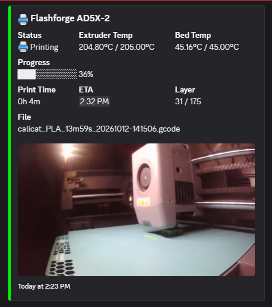

# KILN_NotifyPlus

An add-on for [kiln-notify](https://github.com/djvalic/kiln-notify), the
notifications plugin of [Kiln OS](https://github.com/djvalic/kiln-os) for
the Flashforge AD5X. It adds what
[FLSUN_notify](https://github.com/DIEHARDave/FLSUN_notify),
[U1_notify](https://github.com/DIEHARDave/U1_notify) and
[notify_discord](https://github.com/DIEHARDave/notify_discord) do and
kiln-notify doesn't:

- **Discord cards.** kiln-notify sends plain text with the photo attached.
  With this add-on, Discord webhooks get embeds laid out like
  [FlashForgeUI](https://github.com/Parallel-7/FlashForgeUI-Electron)'s:
  - a colored card with the printer's name, status, and nozzle and bed
    temperatures;
  - while printing: a progress bar, print time, ETA, layer, the IFS slot
    in use and the file name;
  - the camera photo inside the card;
  - a "✅ Print Complete!" card with the total time.
- **"Printer on"** when the printer has just booted.
- **zMod's `TYPE=` switch** for your own messages:
  `_NOTIFY MSG="Door open" TYPE=door` is skipped while `notify_door` is 0.



Which messages are sent, and when, is still set by kiln-notify
(`NOTIFY_SETUP`): start, finish, error, cancel, pause with the reason,
resume, progress, IFS auto-refill, interrupted print and Klipper shutdown.
Other services (Telegram, ntfy, e-mail, ...) keep getting kiln-notify's
plain text. If Discord refuses a card, that message goes out as plain
text.

## Requirements

- Kiln OS with plugin API 1.3 or newer.
- kiln-notify, installed and enabled:

  ```
  INSTALL_PLUGIN NAME=notify ENABLE=1
  ```

  (or **Settings > Plugins > Notifications > Install** on the screen).

## Install

Over SSH as root (Kiln's default password is `root`):

```sh
cd /data/ad5x/plugins
su klipper -s /bin/sh -c 'git clone https://github.com/DIEHARDave/KILN_NotifyPlus.git notify-plus'
```

Then in the console (Fluidd, Mainsail or HelixScreen):

```
ENABLE_PLUGIN NAME=notify-plus
```

Klipper and Moonraker restart. `NOTIFY_PLUS_STATUS` shows whether it's
working.

## Set up

Add your Discord webhook to kiln-notify. In Discord, open the channel's
settings → Integrations → Webhooks → New Webhook → **Copy Webhook URL**:

```
NOTIFY_SETUP URL="https://discord.com/api/webhooks/123456789012345678/abcdef..."
NOTIFY_SETUP NAME="My AD5X"
NOTIFY_TEST
```

Apprise's `discord://webhook_id/webhook_token` form works too. `NAME` is
the card title (default "AD5X"). Then `NOTIFY_PLUS_STATUS` should say
`Discord embeds on for 1 of 1 URL(s)`.

kiln-notify's other settings work as before: `PROGRESS=`, `PHOTO=`,
`EVENTS=`, more URLs.

## Switches

Set these in the console. They're Klipper saved variables, so they
survive a reboot, and they're the same names zMod uses.

| Command | Effect |
| :--- | :--- |
| `SAVE_VARIABLE VARIABLE=notify_discord VALUE=0` | Plain text on Discord again (1 = cards) |
| `SAVE_VARIABLE VARIABLE=notify_on VALUE=0` | No "Printer on" message |
| `SAVE_VARIABLE VARIABLE=notify_<type> VALUE=0` | Mutes `_NOTIFY ... TYPE=<type>` / `NOTIFY ... TYPE=<type>` |

## How it works

kiln-notify sends every message through one method of its Moonraker
component. When Moonraker starts, `notify_plus` (a Moonraker component in
this plugin) wraps that method. Discord webhook URLs are taken out and
get a card built from Klipper's status at that moment (print stats,
temperatures, the IFS, the file's metadata). The rest go to kiln-notify
unchanged. The card type comes from kiln-notify's message text
("Started ...", "Paused ...", "25% ..."), so your own messages appear at
the top of the card.

"Printer on" is sent when Klipper becomes ready within 5 minutes of a
boot, so restarting Klipper or Moonraker later doesn't send it.

`plugin.cfg` replaces kiln-notify's `NOTIFY` and `_NOTIFY` macros with
copies that add `TYPE=`. They call the same kiln-notify method.

`test_notify_plus.py` is an offline test (no network, no printer):
`python3 test_notify_plus.py`.

## Updates

Fluidd / Mainsail > Software Updates > `kiln-notify-plus`, then restart
Moonraker or reboot.

## Removal

```
DISABLE_PLUGIN NAME=notify-plus
```

then delete `/data/ad5x/plugins/notify-plus`. kiln-notify goes back to
plain text.

## Credits

Discord card layout from [FlashForgeUI](https://github.com/Parallel-7/FlashForgeUI-Electron),
by way of notify_discord. kiln-notify by djvalic. zMod's notify plugin
and switch names by ghzserg. GPLv3.
